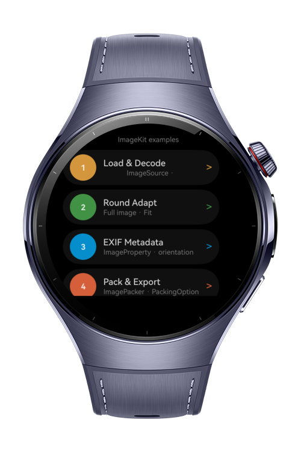
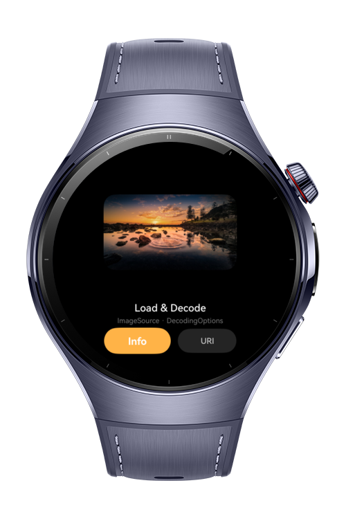
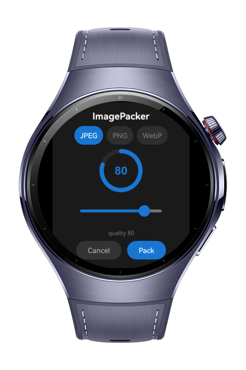

> **Note:** To access all shared projects, get information about environment setup, and view other guides, please visit [Explore-In-HMOS Index](https://github.com/Explore-In-HMOS/hmos-index).

# How to Make Wrist Photo Processor

The Wrist Photo Processor codelab demonstrates a compact ImageKit pipeline for watch thumbnails.
A compact ImageKit sample for HarmonyOS wearables.
The app starts from an ArcList-style example launcher for square-to-round thumbnails, rotate/flip,
region crop/scale, metadata, packing quality, and Picture/AuxiliaryPicture composition.

# Preview
<div>
  
  
  
</div>

# Use Cases
- **Example launcher**: choose the ImageKit concept to run.
- **URI Decode**: stage a bundled photo in cache and decode it again through `createImageSource(uri)`.
- **Round Adapt**: show the full image first, then crop it to a centered square and fit a round thumbnail.
- **Rotate/Flip**: isolate `PixelMap.rotate` and `PixelMap.flip`.
- **Crop/Scale**: isolate `image.Region`, `image.Size`, and scaling.
- **Metadata**: inspect EXIF orientation, decoded RAM, and gain map availability.
- **ImagePacker**: compare JPEG, PNG, and WebP output.
- **Picture**: pack a multi-layer `Picture` with an extracted or generated `AuxiliaryPicture` gain map.

# Tech Stack
- **Languages**: ArkTS / ArkUI
- **Frameworks**: HarmonyOS SDK 6.0.0(20)
- **Tools**: DevEco Studio 5.1.0.260+
- **Libraries**:
  - `@kit.ImageKit`
  - `@kit.ArkUI` (Navigation, NavPathStack, CustomDialog)
  - `@kit.AbilityKit` (UIAbility, resourceManager)
  - `@kit.CryptoArchitectureKit` (secure random utility)
  - `@kit.PerformanceAnalysisKit` (hilog)

# Directory Structure
```
entry/src/main/ets/
├── components/
│   ├── AdjustSheet.ets          # Secondary rotate / flip / square-crop surface
│   ├── AdvancedSheet.ets        # Picture / AuxiliaryPicture action surface
│   ├── MetadataSheet.ets        # Modal with EXIF + gain map info
│   ├── PackOptionsPanel.ets     # Format selector + quality slider
│   └── PreviewCanvas.ets        # Live PixelMap preview
├── constants/
│   └── AppConstants.ets         # Sample list, example list, defaults
├── entryability/
│   └── EntryAbility.ets
├── entrybackupability/
│   └── EntryBackupAbility.ets
├── model/
│   ├── ImageExample.ets
│   ├── PackFormat.ets
│   └── PackResult.ets
├── pages/
│   ├── EditorPage.ets           # Scenario-specific example runner
│   ├── Index.ets                # ArcList-style example launcher
│   └── ResultPage.ets           # Packed thumbnail summary
├── services/
│   ├── ImageExporter.ets        # ImagePacker + PackingOption
│   ├── ImageLoader.ets          # ImageSource + DecodingOptions
│   ├── MetadataReader.ets       # ImageProperty + AuxiliaryPicture probe
│   ├── OrientationFixer.ets     # EXIF orientation -> PixelMap ops
│   ├── PictureComposer.ets      # Picture multi-layer composition
│   └── PixelOps.ets             # rotate / flip / scale / crop(Region/Size)
└── utils/
    ├── Logger.ets
    └── SecureRandom.ets
```

# Constraints and Restrictions
## Supported Devices
- Huawei Watch 5

# License
Wrist Photo Processor is distributed under the terms of the MIT License.
See the [LICENSE](LICENSE) for more information.
